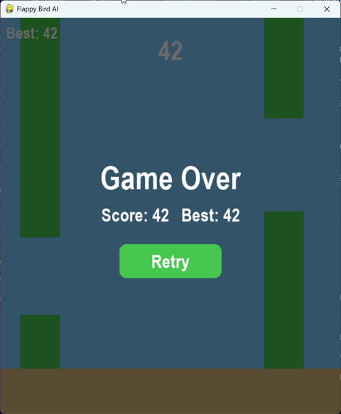

# Flappy Bird AI: NEAT Neuroevolution

A Flappy Bird clone built with **pygame**, plus an AI that learns to play it from scratch using **NEAT** (NeuroEvolution of Augmenting Topologies). No training data and no hand-written strategy: a population of random neural networks evolves, generation by generation, until a bird can fly through pipes it has never seen.


<!-- TODO: record a short GIF of play_ai.py and save it as assets/demo.gif, then keep the line below -->


## Features

- **Playable game**: gravity, jumping, pipes, collisions, score. Press SPACE to flap.
- **Randomised levels**: every pipe has its own random gap size, gap height and spacing, so the AI cannot memorise one layout.
- **Headless simulation**: the game logic is separate from drawing, so training runs with no window, many times faster than real time.
- **NEAT training**: 150 birds per generation share the same game, each controlled by its own evolving neural network.
- **Watch mode**: load the best evolved brain and watch it play, with a Game Over screen, a **Retry** button and a persistent **high score**.
- **Benchmarks**: a hand-written rule-based bot and an evaluation script to measure how reliable a trained brain really is.

## How it works

### 1. The game
`main.py` contains a `Game` class with a clean interface that an AI can drive:

| Method | Purpose |
|---|---|
| `add_birds()` | add a bird to the game (many birds can share one game) |
| `step(actions)` | advance one frame; `actions` has one `True`/`False` (jump) per living bird |
| `get_inputs(bird)` | return the numbers the AI is allowed to "see" |
| `render()` / `draw()` | paint the frame / paint and flip the display |

Creating the game with `Game(draw=False)` skips the window entirely, which is what makes training fast.

### 2. What the AI sees
A neural network cannot see pixels. It receives six normalised numbers (scaled to a small range so no input dominates):

1. Bird height
2. Bird vertical velocity
3. Horizontal distance to the next pipe
4. Vertical offset between the bird and the centre of the gap
5. Where the gap starts
6. Size of the gap

The single output decides the action: **jump if output > 0.5**.

### 3. Evolution (NEAT)
1. Start with a population of random networks.
2. Let every bird play the same game at once.
3. Score each one with a **fitness** function: +1 per frame survived, +1000 per pipe passed (`PIPE_REWARD` in `train.py`).
4. The best networks reproduce with random mutations (weights change, connections and nodes are added) and the weakest disappear.
5. Repeat for a number of generations, then save the best genome.

Settings such as population size, mutation rates and species handling live in `neat_config.txt`.

## Installation

Requires **Python 3.10 or newer**.

```bash
# 1. Clone the repository
git clone https://github.com/OmTripathi29/flappy-bird-neat.git
cd flappy-bird-neat

# 2. Create and activate a virtual environment
python -m venv venv

# Windows (PowerShell / cmd)
venv\Scripts\activate
# macOS / Linux
source venv/bin/activate

# 3. Install dependencies
pip install -r requirements.txt
```

## Usage

| Command | What it does |
|---|---|
| `python main.py` | play the game yourself (SPACE to flap) |
| `python train.py` | train the AI with NEAT and save the best brain to `models/best_genome.pkl` |
| `python play_ai.py` | watch the trained AI play, with Game Over screen, Retry button and high score |
| `python eval_best.py` | test the saved brain over 20 fresh games with no window and print the average |
| `python bot.py` | benchmark a simple hand-written rule on the headless game |
| `python watch_bot.py` | watch that hand-written bot play in a window |

A pre-trained brain is included, so you can run `python play_ai.py` straight away.

## Project structure

```
flappy-bird-neat/
├── main.py            # Game, Bird and pipe logic; run it to play by hand
├── train.py           # NEAT training loop and fitness function
├── play_ai.py         # watch the trained AI (Game Over, Retry, high score)
├── eval_best.py       # reliability test over many fresh games
├── bot.py             # hand-written rule-based bot (headless benchmark)
├── watch_bot.py       # the same bot, with a window
├── neat_config.txt    # NEAT hyperparameters
├── models/
│   └── best_genome.pkl    # best evolved brain
├── assets/
│   └── demo.gif
├── requirements.txt
├── LICENSE
└── README.md
```

## Configuration

| Where | Setting | Effect |
|---|---|---|
| `main.py` | `PIPE_GAP_MIN`, `PIPE_GAP_MAX` | range of random gap sizes (smaller = harder) |
| `main.py` | `PIPE_SPACING_MIN`, `PIPE_SPACING_MAX` | range of random distances between pipes |
| `main.py` | `PIPE_SPEED`, `GRAVITY`, `JUMP_VELOCITY` | game feel and difficulty |
| `train.py` | `MAX_FRAMES` | longest a single generation may last |
| `train.py` | `PIPE_REWARD` | how strongly passing pipes is rewarded in the fitness |
| `neat_config.txt` | `pop_size`, mutation rates | evolution behaviour |
| `neat_config.txt` | `num_inputs` | **must equal** the number of values returned by `get_inputs()` |

## Results

Run `python eval_best.py` to measure the saved brain. It plays 20 fresh games and prints the pipes cleared in each one, plus the average.


A single lucky run proves little, so always evaluate over many games.

## Troubleshooting

- **`RuntimeError: Internal error adjusting spawn counts...`**: with a small population and large `elitism` / `min_species_size`, NEAT can fail to fit all species into the population. Keep `pop_size` comfortably above (number of species x `min_species_size`); this project uses `pop_size = 150`, `elitism = 2`, `min_species_size = 2`.
- **`FileNotFoundError: ... best_genome.pkl`**: run `python train.py` first, or make sure `models/best_genome.pkl` exists.
- **Config / input errors after changing `get_inputs()`**: update `num_inputs` in `neat_config.txt` to match, then retrain. An old saved brain will not work with a different number of inputs.

## What I learned

- Structuring a game loop and separating game logic from rendering
- Designing the inputs, outputs and fitness function of a learning system
- Why evaluation needs many trials: an AI that looks great in one run may just have been lucky
- Debugging mismatches between code and configuration

## Ideas for next steps

- Plot fitness per generation
- Visualise the evolved network
- Train on a different game (for example, dodging falling blocks)
- Moving pipes for a harder environment

## Notes

Built as a learning project. I developed it step by step with an AI tutor (Anthropic's Claude) explaining the concepts while I wrote and debugged the code.

Only load `.pkl` files you trust: Python's `pickle` can run arbitrary code when loading a file.

## License

Released under the [MIT License](LICENSE).